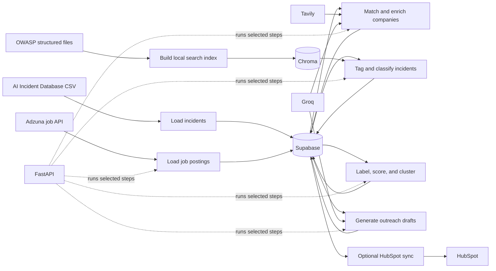

# LeadPilot

LeadPilot is a prototype for finding companies that may be good prospects for an AI security business. It combines public AI incident records, company research, and job postings to build a lead list, score and group companies, and draft outreach messages.

The project is a set of Python scripts plus a small FastAPI service. It is not a ready-to-use hosted product: you need to connect your own Supabase project and third-party API accounts, and set up the database tables the code expects.

## How it works

The scripts are individual pipeline steps. A typical run looks like this:



1. **Prepare incident and hiring data.** `load_incidents.py` imports an AI Incident Database CSV into Supabase. `load_job_postings.py` searches Adzuna and stores matching job listings.
2. **Build company records.** `link_incidents_to_companies.py` associates incident names with companies. `classify_and_clean_companies.py` and `enrich_companies.py` classify and look up company details.
3. **Find AI security signals.** `tag_security_relevant_incidents.py` marks relevant incidents. `ChunkEmbed.py` builds a local Chroma search index from the OWASP material in `data/owasp/`. `classify_incidents.py` uses that index to assign OWASP categories to linked incidents.
4. **Score and group leads.** `label_companies.py` labels companies, `train_scoring_model.py` calculates lead scores, and `cluster_companies.py` groups companies using incident history, hiring activity, and industry.
5. **Prepare outreach.** `generate_outreach.py` drafts a message for a company with a relevant incident or hiring signal. `sync_to_hubspot.py` can send company details to HubSpot.

The scripts write to Supabase as they run. Some also call external services, and some can delete records. Review each script and use a development database before running the pipeline against important data.

## What you need

- Python 3.13.
- A Supabase project with the tables and columns used by the scripts: `companies`, `ai_incidents`, `company_incidents`, `job_postings`, `company_enrichment`, `outreach_messages`, and `crm_sync_log`.
- API credentials for the services you use. The API server imports several pipeline modules at startup, so it currently expects all of these variables even if you only want to use one route:
  - `SUPABASE_URL`
  - `SUPABASE_SERVICE_KEY`
  - `ADZUNA_APP_ID` and `ADZUNA_APP_KEY`
  - `GROQ_API_KEY`
  - `TAVILY_API_KEY`
- `HUBSPOT_ACCESS_TOKEN` if you run the optional HubSpot sync script.

The repository does not include Supabase schema or migration files. You must create the expected tables and columns in your own project before running the data pipeline.

The full AI Incident Database snapshot is not included. `load_incidents.py` expects `data/mongodump_full_snapshot/incidents.csv`, and `tag_security_relevant_incidents.py` expects `data/mongodump_full_snapshot/classifications_MIT.csv`. Obtain the source data yourself and check its terms before using or redistributing it.

## Configure credentials

Create a `.env` file in the repository root. Keep it private; it is excluded from Git.

```dotenv
SUPABASE_URL=https://your-project.supabase.co
SUPABASE_SERVICE_KEY=your-supabase-service-role-key
ADZUNA_APP_ID=your-adzuna-app-id
ADZUNA_APP_KEY=your-adzuna-app-key
GROQ_API_KEY=your-groq-api-key
TAVILY_API_KEY=your-tavily-api-key
HUBSPOT_ACCESS_TOKEN=your-hubspot-access-token
```

Only add the HubSpot variable if you use `sync_to_hubspot.py`. Never commit real credentials or share a service-role key. That key has broad access to your Supabase data.

## Run locally

From the repository root, install the dependencies and create the local OWASP index:

```powershell
py -m venv .venv
.\.venv\Scripts\Activate.ps1
py -m pip install -r requirements.txt
py src/ChunkEmbed.py
```

The first index build may download a sentence-embedding model. It writes the Chroma database to `chroma_data/`, which is intentionally ignored by Git and must be generated on your machine.

Start the API bound to your own computer:

```powershell
py -m uvicorn src.api:app --host 127.0.0.1 --port 8000
```

Open <http://127.0.0.1:8000/docs> to inspect the available routes. The API server needs the environment variables listed above and a working Supabase project.

## API routes

| Route | Purpose |
| --- | --- |
| `GET /health` | Basic process health check. |
| `GET /leads` | Return scored companies. |
| `POST /ingest-jobs` | Fetch Adzuna job postings. |
| `POST /enrich` | Classify and enrich companies. This can delete rows and call Tavily and Groq. |
| `POST /classify-incidents` | Tag and categorize linked incidents. |
| `POST /score-and-cluster` | Label, score, and group companies. |
| `POST /generate-outreach-batch` | Draft messages for leads that do not have one yet. |
| `POST /generate-outreach/{company_id}` | Draft a message for one company. |

**The API has no authentication. Keep it local or put access controls in front of it before hosting it.** The service-role key lets the app access Supabase with broad privileges, and several routes modify data or make calls that may use paid API quotas.

## Notes

- `data/owasp/` contains the structured OWASP material used to build the local search index. `data/owasp/owasp_chunks.json` is not used by the current `ChunkEmbed.py` script.
- `fetch_and_chunk_owasp.py` downloads OWASP PDFs and extracts text, while the current index build uses the structured JSON files already in `data/owasp/`.
- `sync_to_hubspot.py` is a standalone script; it is not exposed as an API route.
- This project is a prototype. Scores and generated outreach should be reviewed by a person before being used for business decisions or sent to anyone.
